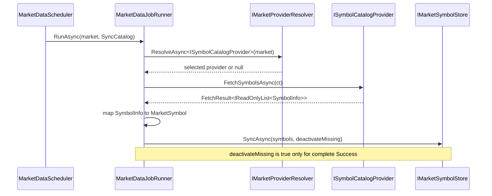
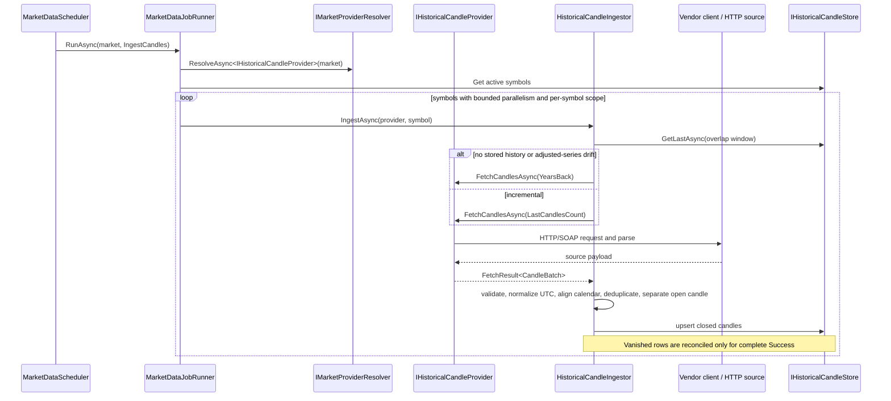
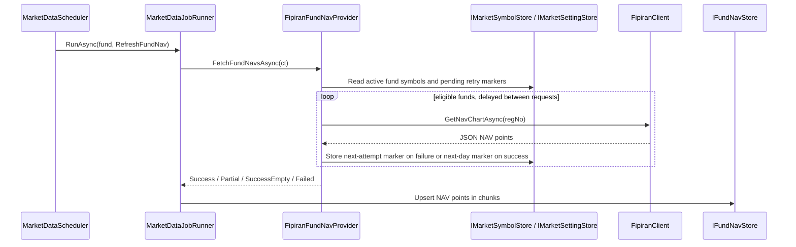

# Data flow

## Catalog sync

`SuccessEmpty`/`Failed` do not deactivate anything. `Partial` can add or update received symbols but does not deactivate missing catalog entries.

## Historical candle ingestion

Daily candles are the current persistence base. Weekly and monthly reads can be derived from daily history; incomplete weeks/months are excluded. The provider's adjustment descriptor tells ingestion whether source values are already adjusted. An adjusted-series drift may trigger a full refetch; replacement is skipped if the full response fails or is too short.

When candle ingestion returns an unfinished current-day candle and no current-state provider is selected for that market, `MarketDataJobRunner` stores its prices as a current-state snapshot. When a dedicated current-state provider exists, the candle-derived fallback is skipped.

## Fund NAV

The Fipiran provider is an exception to the simple adapter boundary: it reads market/symbol/setting stores and persists retry state itself. The runner maps returned NAV DTOs to `FundNavPoint` and upserts them.

## Provider selection and source identity

For each `(market, capability)` the resolver filters registered `IMarketDataProvider` instances by capability and market key, then checks the stored `Provider:<Capability>` value. If there is a single candidate, it can be selected without a saved choice. Multiple candidates require an explicit or bootstrapped default. The selected provider key is available for logs/configuration but is not stored on `HistoricalCandle` rows.
