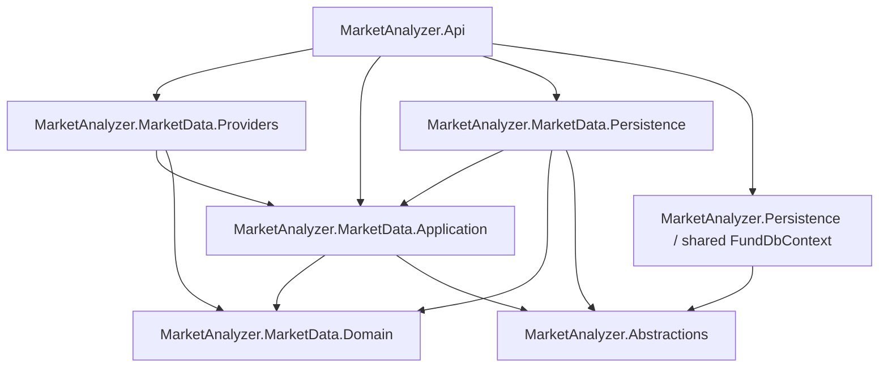

# Dependency map

## Project references



Arrows point from a consuming project to the project it references. Project files are under `backend/MarketData/src/`; the host calls the registration extensions from `backend/MarketAnalyzer.Api/Program.cs`.

## Responsibilities by layer

```text
Vendor network/API
   ↓
Providers (clients, source parsing, mapping to Application DTOs)
   ↓ capability interfaces / FetchResult<T>
Application (resolver, jobs, validation, calendar, ingestion, read models)
   ↓ store interfaces
Domain (entities, enums, store ports)
   ↑ implemented by
Persistence (EF configurations and store adapters)
   ↓ composed by
API host + shared FundDbContext/migration assembly
```

The separation is not absolute: `FipiranFundNavProvider` reads market/symbol/settings stores and writes retry markers itself. Most candle adapters stay closer to a pure source adapter.

## Provider-to-data path

```mermaid
graph LR
    S[MarketSettings: active provider] --> R[MarketProviderResolver]
    R --> I[Capability provider]
    I --> C[Vendor client]
    C --> M[Parse and map]
    M --> F[FetchResult DTO]
    F --> J[MarketDataJobRunner]
    J --> V[Application ingestor / mapping]
    V --> T[Domain store interface]
    T --> E[EF store in MarketData.Persistence]
    E --> DB[Shared host context / marketdata schema]
```



## Direct package and framework edges

- Application: `Microsoft.AspNetCore.App` framework reference; Domain and Common abstractions project references.
- Providers: Application and Domain project references; `System.ServiceModel.Http` for generated TSETMC SOAP code.
- Persistence: Application, Domain, Common abstractions; SQL Server EF Core and BulkExtensions packages.
- Shared hosting/persistence and migrations are outside the four-project MarketData group.
